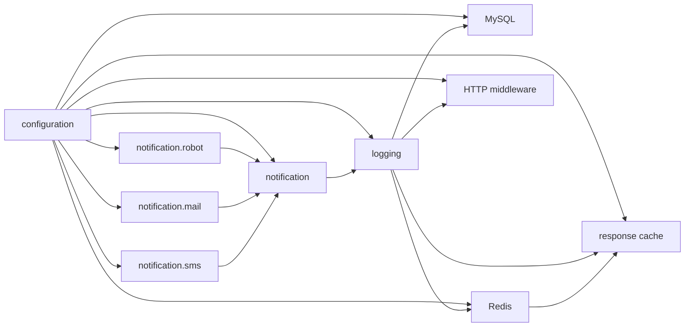

# 通知通道可插拔方案与分阶段实施计划

编制日期：2026-10-22（Asia/Taipei）。文档版本：已批准方案，阶段 1 已完成。

> 用户已同意方案，并明确仅执行阶段 1（1.1–1.4）；阶段 2–5 未获实施授权。阶段 1 只固定项目契约与基线，不切换生产通知路径。实施记录见第 17 节；没有实际证据的设计与验收项仍为待实施、待验证。
>
> 本文不代表通知插件已经实现。不续跑既有插件重构、日志性能优化或验收整改任务，不改动它们的计划及完成记录。阶段 1 允许相关基线、构建、vet、lint、race 与必要 OpenSpec 工件；不操作数据库、容器或发送真实通知。

## 1. 需求来源、目标与范围

需求来源为用户本轮指令：“先针对通知通道可插拔出完整方案和分阶段实施计划，沿用现有插件机制，明确日志、机器人、邮件和短信的依赖与生命周期边界，落盘给我看，先不要改代码。”

后续实施授权：“方案同意，按 docs/notification-channels-plan.md 先执行阶段 1，开始前回读计划和错误记录，完成后逐项验收、更新计划并汇报，不要自动进入阶段 2。”本次仅据此执行阶段 1。

推荐方案：沿用 `core.Plugin` / `PluginRegistry`，入口显式选择机器人、邮件、短信及通知组合插件；日志插件接收通知能力，停止自行构造通知客户端。通知组件先于日志初始化，晚于日志停止；补足日志队列迟到回调和在途发送的保护。

### 1.1 目标与可验证成功标准

| 编号 | 目标 | 实施后的验收证据要求 |
|---|---|---|
| G1 | 日志能够独立使用 | 使用有效日志输出配置，仅配置与日志插件即可初始化、写入、排空；三个通知客户端构造次数均为 0 |
| G2 | 三种通道分别可替换 | 入口替换任一通道为自定义实现，其余通道、通知扇出和日志调用点不变；替换实现实际收到相同契约的输入 |
| G3 | 使用现有注册器管理依赖 | 依赖图无环；正常关闭、Init/Start 失败回滚均证明日志先于通知组合及通道停止 |
| G4 | 单一资源所有者 | 每份客户端只构造一次；成功、部分失败、重复 Stop 均不重复关闭；借用者不调用底层关闭 |
| G5 | 生命周期结束后不再触达发送后端 | SDK 迟到回调、并发发送/Stop、重复 Stop、过期 drain context 下，禁止新的网络发送；在途调用未退出时不关闭其资源 |
| G6 | 保持既有有效配置及消息语义 | 平台默认、目标覆盖、邮件主题/正文、短信逻辑模板/签名/参数、10 秒发送预算、64 深度告警队列均有对应验证 |
| G7 | 故障不递归、不伪装成功 | 发送失败不触发新的 H 系列日志；其余通道继续；构造失败阻止启动；取消、跳过、失败和实际发送成功分开记录 |
| G8 | 服务与迁移入口一致 | 默认 server 与 migration 都显式接入通知组合；迁移不新增 Redis、HTTP 或业务模块依赖 |
| G9 | 同时兼容工作区与锁定依赖 | workspace 与 `GOWORK=off` 分开构建、验收；不使用仅本机 SDK 才有的 API |

### 1.2 非目标

- 不升级 gtkit 依赖，不修改上游包、本机 workspace SDK、`go.mod`、`go.sum` 或 `go.work`。
- 不新建另一套插件注册器、供应商自动扫描或动态加载机制；不调整现有模块层级、移动既有目录。
- 不接入新的短信供应商、SMTP 服务或机器人平台；本期默认仍为现有三家机器人平台、SMTP 和阿里云短信。
- 不增加管理界面、通知 HTTP API、热更新配置、持久化消息队列、异步任务队列、去重库、投递补偿或承诺必达。
- 不新增全局 Logger、全局 Notifier、全局可变供应商注册表或第二套异步通知队列。
- 不重做日志性能优化、OTel 导出、readiness、业务告警触发规则、HTTP 中间件或 worker 关停顺序。
- 不修改数据库、Redis 键、库号、TTL、存储结构或迁移文件。
- 不移除 `SendPicMsg` 等既有辅助能力，不借本期清理其他 gtkit 包。

“实现可替换”不等于“配置支持任意供应商”或“SDK 从依赖图移除”。新增供应商名、凭据结构或依赖裁剪仍需另行明确范围。

## 2. 本轮实际核对的现状与证据

### 2.1 项目源码

| 已读取位置 | 当前事实 |
|---|---|
| `internal/core/plugin.go`、`internal/core/plugin_registry.go` | 现有生命周期为 Name / Init / Start / Stop；先全部 Init 再全部 Start；依赖拓扑排序、逆序清理、失败回滚、共享结果及取消等待已有实现；默认启动/回滚/停止总预算分别为 30 秒，启动单回调 context 预算为 10 秒；不能强制终止不合作回调 |
| `cmd/plugins.go` | server 注册配置、日志、MySQL、Redis、缓存、中间件；migration 注册配置、日志、数据库；构造与 Register 不读配置、不做资源 I/O |
| `internal/bootstrap/plugin_registration.go` | PluginSet 的六种基础能力及 DrainLogs 为必填；不适合为了通知能力再增加一个必填字段 |
| `internal/plugin/builtin/logging/options.go` | mainOptions 内部调用 news.NewWithConfig；SDK Messager 与深度 64 的队列在日志构造时接入 |
| `internal/plugin/builtin/logging/plugin.go` | main/access 共用日志 owner；关闭接纳、等待在途写入、释放门面绑定、Sync access/main；Drain 与 Stop 共用一次清理 |
| `internal/pkg/news/news.go` | 通知器内部创建邮件与短信客户端；按 webhook → mail → 逐个手机号 SMS 顺序同步扇出；每次外部发送独立 10 秒；失败仅记普通 Error |
| `internal/pkg/mail/mail.go` | mailx 客户端封装；host 空返回 nil；host 非空时构造客户端，是否用于告警另外取决于 alert_to；现有封装未暴露 Close |
| `internal/pkg/sms/sms.go` | smsx 阿里云封装；provider 空返回 nil，仅接 aliyun；接收逻辑模板名；现有封装未暴露 Close |
| `internal/platform/config/types.go`、`internal/platform/config/validate.go` | 通道字段与验证集中管理；未启用通道留有其他字段会报错；短信供应商名只接受 aliyun |
| `internal/bootstrap/runtime.go`、`internal/bootstrap/app.go` | 正常由 registry.Stop 清理；仍有存活 worker 时仅调用同一日志 owner 的 DrainLogs，保留共享资源并返回错误 |
| `internal/pkg/news/*_test.go`、mail/sms 测试、logging 测试、`internal/bootstrap/alerting_test.go` | 已存在目标覆盖、超时、错误隔离、日志排空、告警入口等用例；阶段 0 仅阅读，阶段 1 实际基线与回归见第 17 节 |

### 2.2 依赖版本与真实解析来源

下表版本来自本轮读取的 `go.mod`，不是候选升级版本。

| 模块 | 锁定版本 | 本期处理 |
|---|---|---|
| github.com/gtkit/logger/v2 | v2.3.0 | 保留；只改项目内适配 |
| github.com/gtkit/msgbot | v1.4.0 | 保留；默认机器人实现使用 |
| github.com/gtkit/smsx | v1.1.0 | 保留 |
| github.com/gtkit/smsx/providers/aliyun | v1.1.0 | 保留；默认短信实现使用 |
| github.com/gtkit/tools/mailx | v0.0.0-20260730133614-5f1552d9b037 | 保留；默认邮件实现使用 |
| github.com/gtkit/news | v1.1.10 | 保留；现有图片消息辅助能力仍引用其接口 |
| github.com/gtkit/stringx | v1.1.6 | 保留现有标题拼接，不顺带替换 |

只读执行 `GOTOOLCHAIN=local go env GOMODCACHE` 与 `GOTOOLCHAIN=local go env GOWORK` 均 exit 0；实际位置如下：

```text
模块缓存：/Users/xiaozhaofu/go/pkg/mod
生效 workspace：/Users/xiaozhaofu/go/src/Project/gin_api/go.work
workspace 本地 logger：/Users/xiaozhaofu/go/src/my-gtkit-package/logger/v2
workspace 本地 mailx：/Users/xiaozhaofu/go/src/my-gtkit-package/tools/mailx
```

已读取两份 logger 的 message、Sync 及相关配置源码，发现必须覆盖的差异：

| 来源 | 实际源码行为 | 设计影响 |
|---|---|---|
| 锁定 logger v2.3.0 | 单消费者；队列满丢通知；Sync 关闭队列后等待消费者退出；没有可传入的 context 或 error 返回 | 不能只靠 registry 的 30 秒 context 硬切 SDK Sync；需让通知发送遵守排空取消 |
| 本地 workspace logger | 单消费者；排空超时后 Sync 可以返回；源码仍允许后台消费者继续执行队列里的回调；排空选项注释默认 5 秒 | Sync 返回不能证明没有迟到回调；停止通知时必须关闭接纳、取消/等待在途、保护通道资源 |
| 两份 mailx 的已读发送入口 | Send 经 DialAndSendWithContext；本期使用的封装未暴露常驻连接关闭接口 | 不为它编造 Close；默认实现不额外创建连接池或清理 goroutine |

SDK 的丢弃计数在已读 logger 实现内为内部字段，本项目目前没有该计数的公开采集入口。不得把“SDK 内部计数”写为“项目已有可查询丢弃指标”。

上述为阶段 0 的源码核对，不代表真实供应商网络验证。阶段 1 的本地基线与回归另见第 17 节；本机 SDK 特有的排空 API 不进入项目代码。

### 2.3 历史记录与本期独立性

已实际读取全局规则、项目 AGENTS、项目错误记录入口及相关日志/关停错误条目。重点沿用以下约束：工厂返回后检查取消；带资源错误也需清理；typed nil 不当作可用能力；旧 owner 不撤销新绑定；并发关闭用确定屏障验证；不把检查脚本退出码或模拟结果扩大为真实送达证据。

既有 `docs/plugin-registry-plan.md` 与 `docs/logging-performance-plan.md` 仅作为既有边界来源，其历史通过结果不算本专项基线。已有 `docs/acceptance-remediation-plan-2026-10-22.md` 不在本轮修改范围。

## 3. 外部耦合点逐项清单与兼容约束

以下清单来自实际读取的日志适配及 news/mail/sms 源码，作为实施和验收的逐项对照表。

| 耦合点 | 当前值/语义 | 本期对应处理 |
|---|---|---|
| 日志入口与 SDK | 项目 LogEntry.Alert 映射 HError；普通 Error 不触发通知；main/access 单一 owner | 保留；更换通知实现不修改业务日志调用 |
| SDK 消费接口 | Send(msg) 与 SendTo(url,msg) | 日志侧薄适配保留两种调用；传给通知端的显式 url 不丢失 |
| 队列与工作线程 | 项目队列深度 64；已读 SDK 均为单消费者；满队列非阻塞丢通知 | 保留容量与串行语义；通知插件不再建队列 |
| 默认目标与平台 | news.fsurl；platform 留空按 feishu，支持 dingtalk/wecom；平台归一化后选择 | 默认实现保持此契约，不改字段名 |
| 显式目标覆盖 | Warn 的 url 非空只覆盖本次机器人目标；邮件与短信仍照常扇出 | 保留；不能将一次 SendTo 解释为只发机器人 |
| 机器人加签 | news.secret 交给相同平台的 msgbot provider | 留在机器人默认实现；不得泄漏到其他通道或日志 |
| 机器人 HTTP | provider 按本次目标构造，未注入客户端时使用 SDK 的共享客户端；Timeout 为 10 秒；当前未设置 Retry | 保留按目标构造和共享客户端；不关闭 SDK 全局客户端；项目不新增重试 |
| 标题与编码 | 标题含 env、time.DateTime；args 用空格连接；平台 JSON 编码由 SDK 承担 | 字节/字段含义保留；不改成新通用消息协议 |
| 邮件启用与认证 | host 非空启用；port=0 回落库默认 25；user 空不认证；From/FromName 与 implicit_ssl 透传 | 由邮件插件装配现有 Client；不改变 TLS 策略或凭据来源 |
| 邮件告警目标与内容 | alert_to 非空接入告警；主题为 [env] service alert；Text 为原始 args 空格拼接 | 保留；不把机器人时间标题添加到邮件正文 |
| 短信启用与厂商 | provider 非空启用；当前仅 aliyun | 默认实现保持；替换工厂不自动扩展配置白名单 |
| 短信凭据与区域 | access_id/access_secret；region_id 空时驱动回落 cn-hangzhou | 原样翻译至默认实现，不复制密钥或改区域默认 |
| 模板和签名 | 逻辑模板名 → code/sign_name；逐模板签名空时回落全局 sign_name | 原映射、优先级、错误判别保留 |
| 短信告警负载 | alert_phones 与 alert_template 成对；按手机号逐个发送；params 固定为 env 字段 | 保留，不引入任意告警正文短信或并发群发 |
| 发送超时与重试 | 当前通知器每次 webhook、mail、每个手机号 SMS 分别给 10 秒；项目无额外重试循环 | 保留单次 10 秒上限；增加排空/停止取消传递；不承诺未经核实的底层网络尝试次数 |
| 状态与存储 | 无数据库、Redis、持久队列、TTL、幂等键或投递回执存储 | 本期均不新增；有界内存队列仍为尽力投递 |
| 配置中的 AppID/AppSecret | 当前文本告警发送路径不使用 news.appid/appsecret | 不删除字段，不移作 webhook 凭据，不声称已经用于本链路 |
| 其他辅助能力 | SendPicMsg 仍使用 gtkit/news.AppNewser | 保留现有辅助方法及其语义 |
| 入口范围 | server 与 migration 当前均经日志构造间接创建通知器 | 两个入口都改为显式组合，避免迁移入口悄悄丢失既有告警能力 |

对既有通知路径明确调整以下两项，须在阶段 1 固定预期、阶段 4 同步说明；新增可替换实现的 panic 隔离和状态错误契约另见第 8 节：

1. 默认机器人 URL 为空、且本次没有显式 URL 时，跳过机器人发送，不再制造“webhook url is empty”的普通错误日志；邮件和短信独立工作。默认 URL 为空仍允许已注册机器人能力处理显式 SendTo。无机器人实现而出现显式目标时记“能力未注册”，不伪装送达。
2. 加入插件停止接纳、在途保护与排空取消后，预算耗尽或 Stop 之后的通知被拒绝/取消；不再允许迟到回调使用已关闭后端。这是生命周期补强，不作投递必达承诺。

如实施发现其他运行语义必须变化，先修订本文影响和验收项，再取得相应阶段授权。

## 4. 候选方案与选择

| 候选 | 方式 | 正确性与容量 | 改动/维护成本 | 运维与回滚 |
|---|---|---|---|---|
| A：通道插件 + 通知组合，日志依赖通知组合（推荐） | 三个通道分别实现现有 core.Plugin；通知组合只借用通道；日志接收通知能力 | 无依赖环；逆序停止天然满足先日志后通道；沿用 64 队列和单消费者；补接纳/在途门禁解决迟到回调 | 新增四个 builtin 同层实现包及少量项目契约；不改 Core 排序，不增加队列 | 部署配置兼容；默认组合能整体回退；无需新中间件 |
| B：先启动日志，再启动依赖日志的通知插件 | 日志初始装入可变中继，通知 Start 后绑定 | 若直接逆序关闭，通道会先于日志队列停；需额外的二阶段停止与早期通知策略 | 要改绑定发布、早期缓存和停止协调；并发状态及重复清理更多 | 回滚涉及日志中继与通道协同，排错成本更高 |
| C：只在现有通知器内注入三个工厂 | 通知仍由日志 Init 创建和拥有 | 可换发送器，但日志/通知生命周期仍耦合；不能独立注册和选择通道 | 初始改动最小；后续独立资源所有权仍需再拆 | 可回退，但未完整达到本轮目标 |

选择 A。通知初始化只做配置翻译、客户端构造与能力发布，依赖配置；不发初始化测试消息，不依赖日志插件或数据库。初始化失败直接返回错误，由入口诊断；发送期错误经普通日志门面报告，属于不拥有资源的诊断回调，不形成“通道必须先启动日志”的依赖。

现阶段没有真实告警频率、消息大小、收件人数、团队人日或供应商配额数据，不编造精确容量与工期。成本对比是结构判断；量化输入、公式和发布条件见第 11、15 节。

## 5. 项目契约与拟定实现边界

5.1 的类型契约已在阶段 1 新增，尚未接入生产路径；下述注入式通知器、通道插件和生命周期行为仍待后续获准阶段实现。

### 5.1 契约归属

复用 `internal/pkg/news` 作为通知扇出的使用方，在其中新增不含 SDK 类型的契约文件。`internal/plugin` 只为装配端提供通知能力别名，沿用现有 Logger 能力的处理方式。news 不依赖 core、builtin、bootstrap 或业务模块。

```go
// 阶段 1 已新增于 news；接口声明不代表后续组件已实现。
type MailMessage struct {
    To      []string
    Subject string
    Text    string
}

type WebhookSender interface {
    Send(ctx context.Context, target, text string) error
}

type MailSender interface {
    Send(ctx context.Context, message MailMessage) error
}

type SMSSender interface {
    Send(ctx context.Context, phone, templateKey string, params map[string]string) error
}

type AlertSink interface {
    Warn(target string, args ...string)
}

// 只给日志 owner 的排空协作能力；不授予 Stop 或 Close 权限。
type AlertDrainBinder interface {
    BindDrain(ctx context.Context) (release func())
}

type NotificationSink interface {
    AlertSink
    AlertDrainBinder
}
```

news 增加接收 context 的核心扇出入口，接收已翻译的选项及上述 sender；原 Warn/ErrRecord 的 nil 安全与同步扇出语义保留，不增加包级默认实例。原 NewWithConfig 的工厂构造职责在阶段 3 完成入口切换后移除，防止留下第二条隐式构造路径。

### 5.2 各组件的职责

| 组件 | 创建/持有 | 借用/接收 | 明确边界 |
|---|---|---|---|
| logging 插件 | main/access SDK 日志器、SDK 内部异步队列、日志门面绑定 | NotificationSink（允许为空，代表纯日志组合） | 不 import 机器人/邮件/短信默认实现，不读三类通道配置，不创建或 Stop 通道；仅在自身排空时调用 BindDrain |
| 机器人插件 | 归一化平台配置、按本次目标构造 provider 的发送能力；若自定义工厂返回自有资源则持有其清理句柄 | 配置；默认实现借用 SDK 共享 HTTP 客户端 | SendTo 目标逐次生效；默认 URL 空不禁止显式目标；不关闭借来的全局 HTTP 客户端 |
| 邮件插件 | 一份 mail.Client 或替换 sender；转换 news.MailMessage 到现有 mail.Message | 配置 | 不构造通知器，不读取机器人/短信字段，不自行打 H 系列日志 |
| 短信插件 | 一份 sms.Client 或替换 sender | 配置 | 不展开为供应商通用注册平台；默认实现保持 aliyun 映射，不构造通知器 |
| 通知组合插件 | news.Notifier、不可变目标快照、发送生命周期 context、接纳/在途保护、drain 取消绑定 | 三个可选 sender、配置、非告警诊断回调 | 不拥有 sender 的 Close；不新建队列；实现 NotificationSink，给日志的能力不包含 Stop/Close |
| cmd 注册入口 | 选择实现、声明真实依赖边、配置默认诊断回调 | 现有注册器 | 构造和注册阶段不读配置、不打开连接；决定启用哪些插件的代码组合 |

默认 mail/sms 不暴露底层 Close，机器人默认借用共享客户端。因此不能为了统一外观而编造 SDK Close 方法。自定义工厂可返回 sender 和一个由其拥有的可选清理函数；该句柄只留在对应通道插件，借用接口不暴露它。工厂内部在返回前拥有其部分资源，异常出口自行回收或明确交回可清理的部分结果。

### 5.3 可插拔规则

- 默认入口显式注册三个通道，配置禁用时插件发布关闭态能力；本期不新增配置开关。
- 替换一个通道，只改入口构造/注册和该实现的工厂；不改日志调用点、另外两个通道或 news 的扇出算法。
- 注册通知组合时，缺少某个已经由配置启用的通道实现属于装配错误，启动失败。禁止把 typed nil 当作“注册成功”。
- 纯日志组合可以不注册通知组合，并向 logging 传空通知能力。默认 server/migration 不采用这个组合，以保持现有配置生效。
- 通知组合缺席不增加 PluginSet 必填项，不修改基础插件验证规则；后续业务若需要通道，按其使用方 port 借用同一实例，本期不额外增加业务注入点。
- 所有配置、收件人 slice、模板 map 都在发布前形成快照，不让调用方修改运行中的目标或参数；每次短信参数独立，防止替换实现保留/修改 map 导致串扰。

## 6. 注册、初始化与停止依赖图

箭头表示“左侧能力就绪后，右侧才能初始化/启动”，与注册器的依赖参数对应。



上图仅聚焦本专项；既有组件之间的原依赖边继续保留。默认通知相关顺序固定为：

```text
构造/注册：只组装对象和依赖名称，零配置读取、零发送
Init：configuration → robot / mail / sms → notification → logging → 其余现有插件
Start：同一拓扑顺序；全部 Init 成功后才进入全部 Start
正常 Stop：其余现有插件 → logging → notification → sms / mail / robot → configuration
```

具体注册规则：

| 名称（拟定） | 必须声明的依赖 |
|---|---|
| notification.robot / notification.mail / notification.sms | configuration |
| notification | configuration + 本入口实际选择的通道插件名称 |
| logging | configuration + 已选择的 notification；纯日志组合仅依赖 configuration |
| MySQL / Redis / cache / middleware | 保持原依赖边，不反向依赖通道实现 |

默认注册三个通道，即使某通道未配置，其关闭态插件也不做 I/O。若入口裁掉一个通道，既不保留悬空依赖边，也不能静默忽略其已启用配置。

错误诊断走已有项目日志门面；门面未安装或已释放时使用其既有 stderr 后备出口。诊断回调不得取得 logging 插件所有权或触发通知，因此图中不添加通道 → logging 的依赖边。

## 7. 生命周期、排空与并发协议

### 7.1 状态与接纳

通道和通知组合采用明确状态：created → initialized/disabled → running → stopping → stopped；Init/Start 失败进入 failed。状态为 failed 或 stopped 后不重启；重复 Stop 共享清理结果。

| 阶段 | 通道插件 | 通知组合 | 日志插件 |
|---|---|---|---|
| New / Register | 保存工厂、配置提供方；不调用工厂 | 保存可选 sender 与诊断回调 | 保存配置及通知能力 |
| Init | 读配置，构造单份客户端；发布前检查取消、typed nil 和错误 | 验证配置与通道存在性；冻结目标；创建独立生命周期 context，不保存会过期的 Init context | 构造 SDK main/access；接入借用通知能力；原子安装既有门面 |
| Start | 校验 initialized/disabled；打开发送接纳，不发探测消息 | 打开发送接纳 | 保持现有 Start 校验 |
| 运行 | 每次 Send 接受 context，受自身接纳门禁保护 | 一次接纳覆盖完整扇出；逐通道派生 10 秒 context | H 系列经过 SDK 唯一队列调用通知能力 |
| Stop | 关闭新接纳、取消自有在途 context、等待本插件在途归零，之后才执行自有清理 | 关闭新接纳、取消生命周期、等待被接纳扇出归零；解除 drain 回调绑定 | 关闭日志新写、等待已接纳写入；绑定 drain context；Sync access/main；释放绑定由同一 owner 执行 |

接纳与在途登记必须在同一把锁保护下完成，退出在 defer 中归还计数。停止等待使用“在途归零时关闭的完成 channel”与 ctx.Done 选择，避免为 Wait 或 Sync 新起一个超时后被遗弃的 goroutine。反复 Stop、迟到取消与异常返回均只清理一次。

通知组合不向外暴露裸 Notifier 或底层 sender，使 SDK 保存的引用始终经过生命周期代理；迟到回调先检查接纳状态，再读取任何通道引用。

通知组合借用的是各通道插件经过接纳保护的 sender 视图，不是工厂返回的裸客户端。即使组合 Stop 超时，后续通道 Stop 也能独立阻止新增发送，并保护自己的在途资源。

### 7.2 BindDrain 的具体契约

这是本方案解决两份 SDK 关闭差异的必要协作，不是第二套生命周期管理器。

1. 日志 owner 在 Drain/Stop 或部分构造失败的清理中，进入可能阻塞的 SDK Sync 之前，对已注入通知能力调用 BindDrain，传入本次真实清理 context。
2. BindDrain 不调用通道 Stop/Close，也不立即阻止预算内待处理消息；它将该清理 context 的取消传播到通知生命周期及已经在途的发送。实现可使用短小的 context.AfterFunc 取消回调；不得用 goroutine 包装 SDK Sync。
3. 既有在途发送和后续 SDK 回调都经过同一个通知生命周期取消源；达到 deadline 或收到强制取消后，后续回调只记录取消/拒绝，零新增外部发送。
4. 返回的 release 只解除本次取消注册并等待已开始的短取消回调结束，不关闭通道、不恢复已取消的生命周期。异常和重复清理都必须安全。
5. 默认实现必须合作式响应取消；自定义实现也必须遵守同一契约。文件 I/O、SDK 非合作调用和被接纳的任意阻塞格式化仍没有可强制中断的保证。
6. 该接口只交给日志 owner。普通发送能力不含绑定排空 context、Stop 或 Close 权限。

锁定 SDK 因而可以在清理预算耗尽后让队列中的通知回调尽快返回；workspace SDK 即使先结束等待，后续仍由通知 Stop 的接纳门禁和通道在途保护兜底。两者都不能把 void Sync 解释为真实送达确认。

### 7.3 正常退出

1. App 按现有顺序停止 producer、HTTP 和 consumer，记录退出告警；不移动既有退出告警时点。
2. 注册器逆序停止其他资源，再调用 logging.Stop。
3. logging 拒绝新日志写入，等待已接纳写入，绑定 drain context 并执行 SDK Sync。通知组合和通道此时仍存活。
4. notification.Stop 关闭接纳并取消仍在途发送；SDK 后续回调不能再访问发送后端。
5. 各通道 Stop 等待自身在途归零，才清理自有资源。SDK 共享客户端保持借用语义。
6. 清理错误与取消逐层聚合，不仅返回最后一项。

### 7.4 部分失败、取消及资源不能释放

| 场景 | 必须处理 |
|---|---|
| 机器人成功、邮件工厂失败 | 邮件工厂部分资源由邮件 owner 清理；注册器回滚已进入 Init 的前缀；不调用尚未进入 Init 的短信工厂 |
| 所有通道成功、通知或日志 Init 失败 | 按逆序清理已初始化资源；日志若已有队列先完成自己的清理，再停通知/通道 |
| 任意 Start 失败 | 回滚全部已经 Init 的插件，包括尚未 Start 的通道；未 Start 能力零发送 |
| 工厂返回后 ctx 取消 | 同一个 Init owner 立即撤回发布并清理，返回取消及清理错误，不能留下可 Start 的能力 |
| SDK Sync 返回但后台还有调用 | 组合层和每个通道层均以接纳/在途门禁阻止关闭后使用；保留稳定代理，不能把其指针直接置 nil 后让旧回调解引用 |
| 某自定义 Send 无视取消 | Stop 不能关闭其仍在使用的资源；在预算结束时返回可判别的未排空错误，保留资源所有权及引用，标记未释放，交由进程退出收回；不谎报已关闭 |
| notification.Stop 返回未排空，注册器继续 Stop 通道 | 各通道必须独立保护自己的在途资源，不能依赖父插件返回成功才能安全；未归零的通道同样返回未释放错误 |
| App 还有存活 worker，仅执行 DrainLogs | 只排空相同 logging owner；通知发送随 drain context 取消，但不擅自执行通道 Stop；共享资源继续保留，结果仍为异常退出 |
| 重复 Stop / Drain 或旧 owner 迟到清理 | 共享同一次清理结果；不重新入队、不重复释放、不覆盖后来者的门面绑定 |

不改 Core 在错误后继续尝试其他 Stop 的既有行为。资源安全由每个拥有资源的插件独立保证。

## 8. 发送、失败与数据契约

| 项目 | 固定设计 |
|---|---|
| 通知扇出 | 保留 webhook → mail → 顺序 SMS；单个通道返回错误后继续下一项；单个手机号失败不阻断后续手机号 |
| 单次预算 | 每次外部调用为 10 秒，且受调用 context、通知生命周期取消及 drain 取消共同约束；不把三种通道误设为共享一个 10 秒总预算 |
| 重试 | 本期项目层重试次数为 0；机器人保留 Retry 零值；SMTP 不加重试；短信封装不加重试。阶段 1 已沿真实调用链核实阿里云 OpenAPI 循环最多一次初始尝试、SDK 循环重试为 0，见 17.3；不将此扩大为实测网络请求次数或必不重复投递 |
| 一致性/送达 | 尽力投递；无持久化或业务事务关联；可能因队列满、取消、进程退出丢通知，网络响应不确定时也不能承诺无重复；不宣称最终必达或 exactly-once |
| 失败隔离 | 在每个可替换 sender 调用边界恢复实现 panic、归还在途计数并记录普通错误，随后处理其他通道；不把 panic 当作发送成功 |
| disabled / missing / stopped | 未配置正常跳过；配置已启用但实现缺失启动失败；停止后的调用拒绝且零网络；三种情况不混写为成功 |
| 目标与参数 | 冻结配置 slice/map；短信逐调用复制可变参数；不把 SDK 类型、供应商模板号或认证凭据交给通知组合 |
| 关闭权限 | sender 接口不含 Close；只有各自插件持有真实清理句柄；自定义资源的借用/拥有方式必须在工厂边界明确 |
| 初始化探测 | Init/Start 不发送“测试通知”，不依赖下游在线才能完成本地构造；非法配置/构造错误仍阻止启动 |
| 运行期故障 | 不修改 HTTP 状态码、业务返回值或 readiness；继续现有普通错误诊断；不在本期添加新的服务摘流规则 |

## 9. 配置与兼容策略

本期不增加、改名或删除配置项，不新增 timeout/retry/driver-list 等旋钮。现有 `news.*`、`email.*`、`sms.*` 是唯一配置来源。

| 配置组 | 必须保持 | 后续文档说明应补齐的边界 |
|---|---|---|
| news | fsurl、platform、secret、appid、appsecret 的名称及已有验证；平台默认 feishu | 默认目标空仅跳过本次默认机器人发送；已注册能力仍可接显式目标；AppID/AppSecret 不用于本条文本告警链路 |
| email | host 门控、端口回落、认证、TLS、发件人及 alert_to 规则 | 客户端启用与接入告警分别由 host 和 alert_to 决定；日志不再负责构造 |
| sms | provider 门控、aliyun 白名单、凭据、区域、模板映射与告警目标成对规则 | 逻辑模板、签名回落和 env 参数保持；接口可替换不等于配置已经支持其他厂商 |
| log | 输出、保留策略、门面、64 队列及 H 系列触发意图 | 日志借用通知能力；纯日志组合无需创建通道 |

实施阶段必须同批核对配置结构注释、验证函数、`config/env.yml.example` 与 `config/README.md` 的用途、默认值、回落和关联条件。无配置值变更，因此不迁移部署配置，也不读取或改写真实密钥配置文件。若需要新增配置，先停下修订本方案，不能以“可插拔”为由扩展本期供应商 schema。

## 10. 拟涉及文件与目录边界

本轮实际只新增本文。下面是未来获准代码阶段的文件范围，不代表已经创建。

现有文件的拟修改职责：

| 现有位置 | 拟修改内容 | 所属阶段 |
|---|---|---|
| `internal/pkg/news/news.go` 及既有测试 | 改成依赖注入扇出、增加 context 核心入口、保留消息语义、移除旧隐式工厂入口 | 1–3 |
| `internal/pkg/mail/mail.go`、`internal/pkg/sms/sms.go` 及既有测试 | 继续作为默认 SDK 封装；仅在确有必要时增加实例级工厂注入或完成类型翻译；不新增全局可变测试缝 | 2 |
| `internal/plugin/builtin/logging/plugin.go`、`internal/plugin/builtin/logging/options.go` 及既有测试 | 接收通知能力、移除隐式构造、接入 BindDrain；保留 main/access、字段、调用位置、过滤与 owner 保护 | 3 |
| `cmd/plugins.go` 及 plugins 相关既有测试 | 显式选择通道、声明依赖；server/migration 复用同一通知注册辅助函数 | 3 |
| `internal/bootstrap/alerting_test.go`、plugin_registration/runtime/app 的相关既有测试 | 验证告警仍先于清理、存活 worker 只 Drain、换实现及错误聚合 | 3、5 |
| `config/env.yml.example`、`config/README.md`、`internal/platform/config/types.go` 的相关注释 | 只同步本期行为和职责说明；值、字段和验证规则保持 | 4 |
| `docs/observability.md`、`docs/architecture.md` | 在实现完成后描述已实现的注册/生命周期边界；不改业务分层规则 | 4 |
| 本文 | 按授权阶段追加真实命令、来源、结果及未验证项 | 每阶段 |

拟新增位置按现有层级平铺，不移动既有包；此代码框是计划文件清单，不是现存路径清单：

```text
internal/pkg/news/contracts.go                    通知使用方契约、项目消息类型
internal/plugin/notification.go                   装配侧通知能力别名
internal/plugin/builtin/robot/plugin.go            机器人通道 core.Plugin
internal/plugin/builtin/robot/sender.go            msgbot 默认发送适配
internal/plugin/builtin/mail/plugin.go             邮件通道 core.Plugin 与现有 Client 适配
internal/plugin/builtin/sms/plugin.go              短信通道 core.Plugin 与现有 Client 适配
internal/plugin/builtin/notification/plugin.go     通知组合 core.Plugin
internal/plugin/builtin/notification/drain.go      接纳、在途与 BindDrain 协作
以上新增包对应 *_test.go                          具体测试名以第 12 节契约编号关联
```

不改 Core 算法，不把可选通知字段加进 PluginSet 的非空校验；原则上 bootstrap 生产代码无须新增通道知识。若源码变化使该边界无法成立，先补充真实原因和文件范围再实施，不借测试修复扩展到其他模块。

## 11. 外部调用、容量与可观测性

### 11.1 每类外部依赖的预算和故障处理

| 通道 | 超时 | 项目重试 | 失败处理 | 观测要求 |
|---|---|---|---|---|
| 机器人 HTTP | 每次 10 秒；通知生命周期/drain 可取消 | 0；保留 msgbot Retry 零值 | 普通 Error，继续邮件/SMS；默认目标缺席正常跳过 | channel=webhook，结果分类、耗时；不输出完整 webhook、签名或正文 |
| SMTP | 每次 context 10 秒；保留 mailx/go-mail 自有连接兜底 | 0 | 普通 Error，继续 SMS | channel=mail，结果分类、耗时；不输出密码、正文或完整收件地址 |
| 阿里云 SMS | 每个手机号 context 10 秒；底层重试默认需核实 | 0 | 普通 Error，继续后续手机号 | channel=sms，结果分类、耗时；不输出密钥、手机号或模板参数原值 |

默认诊断回调使用已有项目日志门面的普通 Error；门面释放后沿用其后备输出。结果至少区分 provider_error、timeout、canceled、disabled、missing、stopped、panic；保留现有“alert webhook/mail/sms send failed”错误类别的可识别含义。错误详情必须按项目敏感信息约束处理，禁止把 SDK 原始 URL/凭据报错直接拼入新字段。

本期不提前构造 OTel Recorder，不改变 telemetry 在 bootstrap 的装配顺序，不新增采集后台任务。通道故障日志是本期观测出口；公开队列丢弃指标、供应商配额监控及持久回执均不在实现承诺内。拟定 AlertSink 与现有 SDK Messager 均无投递回执，不能由其返回确认送达。

### 11.2 基于源码的计算，不是性能实测

令 W 为本次是否实际发送机器人（0/1），M 为本次是否发送一封告警邮件（0/1），N 为短信目标数。现有串行模型在各调用合作式遵守 10 秒 context 时：

```text
单条通知的网络等待预算 T ≤ 10 × (W + M + N) 秒 + 本地处理开销
单消费者的理想持续处理速率 ≈ 1 / 平均单条处理时长
日志停止接纳后，通知引用数量最多为 64 条待处理 + 1 条在途
不计取消的网络预算估算 ≤ 65 × 10 × (W + M + N) 秒
队列消息占用估算 ≤ 65 × (消息最大字节数 + 目标 URL 最大字节数 + 引用开销)
```

仅作为计算例：假设 W=1、M=1、N=2，则单条网络预算为 40 秒，65 条为 2600 秒，约 43 分 20 秒；这些目标数是示例假设，不是当前部署事实。该量级说明不能靠队列有界就承诺“30 秒退出”或“必不 OOM”。

本方案通过 BindDrain 在清理取消后停止新发送、取消在途，并在通道 Stop 保护资源；仍不能给文件 Sync、不合作 SDK 或任意自定义 sender 提供硬时限。消息最大长度、峰值频率、实际收件人数、实例数、供应商配额、真实延迟、内存及退出宽限期均未确认。无实测时不填 p99、吞吐、人日、成本或生产准入结论。

### 11.3 资源预算

- 默认继续一个 SDK 告警消费者、64 深度队列；三个通道及通知组合不新增消费者队列。
- Init/Start 不创建后台发送任务；drain 只注册短取消回调并在清理时解除/等待，不遗弃长期协程。
- 默认机器人借用 SDK 共享 HTTP 客户端；SMTP 按现有 Send 路径；默认 SMS 不另起项目连接池。自定义发送器若创建池，必须声明拥有者、上限、取消与关闭能力。
- 本期无新增 DB/Redis 连接、存储量、迁移或持久消息保留期；外部邮件/短信费用与实际发送量有关，当前无可核实月度费用输入。

## 12. 完整方案验收矩阵（新组件行为待执行）

以下描述完整通知插件方案应覆盖的可观察行为。阶段 1 只固定预期并运行既有路径回归，实际证据见第 17 节；下表涉及的新组件、接线和生命周期场景尚未验收。

| 编号 | 场景 | 必须拿到的证据 |
|---|---|---|
| A01 | New/Register 无副作用，纯日志组合 | 构造计数、发送计数、资源计数为 0；无通知能力时日志仍可工作 |
| A02 | 三个通道分别替换 | 每个替换实现确实被调用；默认实现未同时构造；其他通道输入保持不变 |
| A03 | 默认平台、大小写、加签、默认/显式 URL | 真实本地 HTTP 请求或等效输入断言逐项匹配；显式目标不影响邮件/SMS |
| A04 | mail host/alert_to、SMS provider/targets/template 各种门控 | 构造与发送分开计数；配置启用却缺实现报错；typed nil 不通过 |
| A05 | 机器人空默认目标 | 无显式 URL 时零 webhook 调用且不报空 URL；显式 URL 仍调用已注册实现 |
| A06 | 邮件/SMS 内容、配置快照和可变参数 | 主题、正文、逻辑模板、签名回落和 env 参数一致；修改输入 slice/map 不影响运行实例 |
| A07 | 单通道错误、panic、超时、多个手机号 | 后续通道/手机号继续；每次独立 10 秒；无递归 H 系列通知 |
| A08 | Init/Start 失败和迟到取消 | 三个以上插件事件轨迹；部分资源只关闭一次；已 Init 未 Start 项被回滚；错误和取消同时保留 |
| A09 | 日志排空顺序 | 明确屏障证明日志 Sync 执行时通道仍可用；队列回调结束或取消后才允许资源关闭 |
| A10 | workspace 超时返回后的迟到 SDK 回调 | SDK Sync 已返回、后台仍能触发回调的夹具；notification.Stop 后底层发送为 0，零使用已关闭资源 |
| A11 | 锁定 SDK 无 drain-timeout API | `GOWORK=off` 构建和完整相关测试；BindDrain deadline/强制取消切断合作式发送，队列不继续发网络请求 |
| A12 | 在途 Send 与 Stop 并发、重复 Stop | 接纳/归还屏障及 race；禁止 Wait 与新增在途登记竞态；关闭回调恰好一次 |
| A13 | 自定义 Send 无视取消 | 预算结束返回未排空/未释放错误；清理回调未执行；通道仍保存资源；测试主动释放夹具并等待其退出 |
| A14 | drain 绑定建立、取消、解除同时发生 | release 幂等；短取消回调被等待；无对新实例的迟到取消；不保存 Init context |
| A15 | worker 存活只 DrainLogs、退出错误告警 | 同一日志 owner 被排空；注册器/通道 Stop 未被越权执行；返回未关闭资源错误 |
| A16 | server/migration/纯日志入口 | 默认两个入口的通知拓扑和行为一致；migration 不引入 Redis/HTTP；纯日志无需通知实现 |
| A17 | 日志原有契约 | main/access、字段、request_id、caller、动态级别、Alert 绕过普通过滤、旧 owner 绑定保护等既有用例不退化 |
| A18 | 脱敏与诊断出口 | 无完整 URL/凭据/手机号/收件地址泄漏；日志门面释放后仍有普通后备诊断；零递归 |
| A19 | 可复核的负向证明 | 有意打乱停止边、移除在途保护或丢弃显式 URL 后，指定契约用例真实失败；不把编译错误当命中 |
| A20 | 真实供应商端到端 | 仅在另行明确授权、提供专用目标与凭据后执行；分别记录平台接收结果，未授权/未执行保持未验证 |

网络替身只使用进程内 fake、本机回环 HTTP 或本机 SMTP 夹具；不借测试发送真实邮件、群消息或计费短信，不拉镜像或新建容器。测试跳过与环境拒绝不能记为通过。

## 13. 分阶段逐步实施计划

每阶段必须先读取本文、最新用户指令、实际项目错误记录，记录获准步骤；本表“待授权”不能因上一阶段完成而自动变更。阶段内出现范围变化、连续三轮无进展或必须改变已固定兼容语义时停止，说明真实缺口。

### 阶段 0：本轮方案落盘与审阅

| 步骤 | 前置条件 | 具体动作 | 检查方法 / 验收证据 | 停止条件 | 交付物 / 状态 |
|---|---|---|---|---|---|
| 0.1 | 用户仅授权方案和计划 | 读取相关源码、SDK 两种解析来源、规则、历史记录；编写本文 | 事实与设计分开，具备耦合清单、候选、生命周期、文件范围、风险、回滚、验收及逐步计划 | 关键规则不可读，或需改代码才能补充事实 | 本文；已完成 |
| 0.2 | 0.1 保存完成 | 全文回读，核对阶段顺序、授权状态、计划路径及新旧 SDK 差异 | 实际读回内容与本轮需求一致；仅本文发生写入；不运行任何测试或文档门禁 | 文档把设计写为已实现、把历史验证写为当前通过 | 可供用户审阅的完整方案；已完成，记录见第 16 节 |

### 阶段 1：固定兼容契约与基线（已授权，已完成）

| 步骤 | 前置条件 | 具体改动/动作 | 检查方法 / 可复核证据 | 停止条件 | 交付物 / 状态 |
|---|---|---|---|---|---|
| 1.1 | 用户明确批准本文及阶段 1 | 记录当前相关文件差异和依赖解析；核对阿里云真实调用的默认重试；读取相关测试/指南 | workspace 与锁定来源分别记录；不读取真实密钥；SDK 尝试次数有源码依据或明确未确认 | 现状与本文不符，已有他人改动无法安全区分 | 本期独立基线记录；已完成，见第 17 节 |
| 1.2 | 1.1 事实一致 | 运行当前 news/mail/sms/logging/bootstrap/cmd 的相关基线；保留现有失败原件 | 两种环境的完整命令、版本/来源、exit、失败与 skip；历史记录不充当本轮结果 | 原有失败阻断本期验收且不属于授权范围 | 双环境各 13 包、574 测试及子用例通过，失败/skip 为 0；已完成 |
| 1.3 | 基线及兼容表可复核 | 新增 news 项目契约及装配侧别名；不改变生产接线；固定 G/A 编号对应的预期 | 新增类型无 SDK 泄漏、无反向依赖；相关构建与现有用例结果可读 | 契约必须引入新供应商 schema、全局注册表或移动模块 | 两份声明文件及 17.4 契约清单；双环境相关检查通过；已完成 |
| 1.4 | 1.3 完成 | 记录本阶段结果、差异、剩余风险 | G6/G9 对照及阶段检查证据；新行为仍未接入生产路径 | 未验证项被勾为通过 | 17.5–17.8 逐项验收与限制；已完成，停在阶段 1 |

### 阶段 2：通道插件和通知组合（未授权）

| 步骤 | 前置条件 | 具体改动/动作 | 检查方法 / 可复核证据 | 停止条件 | 交付物 / 状态 |
|---|---|---|---|---|---|
| 2.1 | 阶段 1 验收记录齐备，阶段 2 获准 | 新增机器人、邮件、短信插件；实例级工厂、关闭态、资源所有权及在途保护 | A01–A04、A06、A08、A12/A13；工厂/发送/关闭计数及真实错误 | 工厂必须依赖 logging.Init，或需要未获准依赖/目录重排 | 三个可独立替换的通道插件；待执行/待授权 |
| 2.2 | 通道接口和状态可用 | news 增加注入式 context 扇出入口；保留消息语义和原辅助方法；将空 URL 跳过纳入明确契约 | A03–A07、A18；仅 fake/回环输入证据 | 其他有效配置或正文发生未计划变化 | 注入式通知器及契约用例；待执行/待授权 |
| 2.3 | 2.1/2.2 完成 | 新增通知组合插件、生命周期 context、BindDrain 及取消绑定清理 | A09–A14；同时取消和释放的屏障轨迹；无被遗弃等待 goroutine | 仅靠 Sync 返回推断无回调，或在途未退出就清理资源 | 通知组合及生命周期证据；待执行/待授权 |
| 2.4 | 上述组件定向检查通过 | 运行本阶段受影响模块全量相关检查，记录结果 | 两种 SDK 环境的相关 build/vet/lint/race；更新 G2–G5 证据 | 同一问题三轮无进展，或本地 SDK API 被锁定构建拒绝 | 阶段 2 交付；待执行/待授权 |

阶段 2 新组件暂不接入默认入口；旧构造入口只作为阶段 3 切换前的过渡，不能在运行时同时创建两份通知器。

### 阶段 3：日志、server 与 migration 接线（未授权）

| 步骤 | 前置条件 | 具体改动/动作 | 检查方法 / 可复核证据 | 停止条件 | 交付物 / 状态 |
|---|---|---|---|---|---|
| 3.1 | 阶段 2 验收记录齐备，阶段 3 获准 | logging.Options 接收通知能力；mainOptions 移除配置型通知构造；Drain/部分失败清理绑定真实清理 context | A01、A09–A14、A17；日志性能与 owner 既有契约不退化 | 需要改日志后端、放宽过滤/关闭协议或依赖本地特有 SDK API | 日志通知适配；待执行/待授权 |
| 3.2 | 3.1 与通道均可组合 | cmd 默认入口显式注册四个通知相关插件；server/migration 共用注册辅助函数；保留基础 PluginSet | A08/A16；实际拓扑轨迹与缺失/循环依赖错误；迁移组合零 Redis/HTTP | 为通知新增必填 PluginSet 能力，或仅修改 server 遗漏 migration | 两入口接线及组合测试；待执行/待授权 |
| 3.3 | 两入口切换完成 | 删除 news 旧隐式构造职责及其厂商工厂依赖；迁移旧测试到新职责位置；保持 SendPicMsg | 调用方检索与整段回读；仅唯一默认构造点；A02/A06/A17 | 需要删除无关辅助能力或保留第二套活跃实例 | 单一构造路径；待执行/待授权 |
| 3.4 | 3.1–3.3 完成 | 覆盖完整 App/Runtime 回滚、正常停止、存活 worker 只 Drain、workspace 迟到回调 | A08–A17；两环境 race、确定性屏障、真实清理计数 | worker 未退出却关闭通道，或失败只保留最后一个错误 | 阶段 3 交付；待执行/待授权 |

### 阶段 4：配置说明与使用文档同步（未授权）

| 步骤 | 前置条件 | 具体改动/动作 | 检查方法 / 可复核证据 | 停止条件 | 交付物 / 状态 |
|---|---|---|---|---|---|
| 4.1 | 阶段 3 运行行为确定，阶段 4 获准 | 同步配置注释、example 和配置说明；逐项写用途、启用条件、默认/回落及关联 | 对照第 3/9 节与实际代码逐项回读；值与字段未变；纯文字步骤不运行测试 | 出现未计划新配置或需要改真实密钥文件 | 配置说明；待执行/待授权 |
| 4.2 | 配置说明一致 | 更新已实现架构/可观测性说明、入口选实现示例、停止限制及两份 SDK 区别 | 所引用源码真实存在；内容不把 best-effort 写成必达；只有已实现能力进入使用说明 | 需要重写无关规范或把计划当实现 | 使用与维护说明；待执行/待授权 |
| 4.3 | 4.1/4.2 完成 | 回读阶段交付，记录未验证边界 | 文档、示例、代码配置读取一一对应 | 实现/注释/示例口径不一致 | 阶段 4 交付；待执行/待授权 |

若只授权本阶段文字修改，严格只编辑获准文字并回读；第 5 阶段检查不因文档完成而自动执行。

### 阶段 5：总体回归、回退演练与交付（未授权）

| 步骤 | 前置条件 | 具体改动/动作 | 检查方法 / 可复核证据 | 停止条件 | 交付物 / 状态 |
|---|---|---|---|---|---|
| 5.1 | 阶段 1–4 完成，阶段 5 获准 | 运行完整本地验收矩阵及少量关键生命周期反证 | A01–A19 全部逐项记录；反证同时命中指定失败与原因；无 skip 冒充通过 | 任一资源安全、取消、原消息兼容契约失败 | 本专项功能证据；待执行/待授权 |
| 5.2 | 本期定向检查通过 | 按实际 Makefile/指南执行最终门禁，workspace 与 GOWORK=off 分开记录 | 两环境 go build；受影响 race；make check 包括架构、vet、lint、modern、覆盖率等真实结果 | 构建依赖变更、缺工具需安装、隐式容器动作或范围外失败 | 完整门禁报告；待执行/待授权 |
| 5.3 | 基线快照和候选差异清楚 | 在隔离副本演练仅撤销本期差异；对照旧配置与消息契约；不触碰当前工作树其他改动 | 回退后构造/发送路径与基线一致，列出数据/配置无迁移项；命令与退出码可复核 | 无法区分他人改动、需改写历史或操作生产 | 回退演练记录；待执行/待授权 |
| 5.4 | 本地证据齐备 | 形成 G1–G9、A01–A20 与风险的交付矩阵 | 本地开发验收与真实供应商/生产容量分开结论；A20 未执行保持未验证 | 试图以 mock、Sync 或本地门禁代替真实送达/生产准入 | 阶段 5 交付；待执行/待授权 |

第 5 阶段涉及运行行为交付时，按项目要求读取 backend-acceptance 及验收 Guide。真实供应商发送、生产灰度、提交和发布均需其对应的明确授权，本计划不自动授权这些动作。

### 13.1 后续代码阶段的检查命令范围

以下是各代码阶段的检查范围，不能视为全部已经执行。阶段 1 的实际命令和结果见第 17 节；阶段 1/2/3 使用对应相关包集合，完整 `make check` 等最终门禁仍留在阶段 5。

```text
# 获准代码阶段后的相关包检查示意；新增包创建完成后才能执行。
go test -race -count=1 -timeout=5m ./internal/pkg/news ./internal/pkg/mail ./internal/pkg/sms ./internal/pkg/log ./internal/plugin/... ./internal/bootstrap ./cmd
GOWORK=off go test -race -count=1 -timeout=5m ./internal/pkg/news ./internal/pkg/mail ./internal/pkg/sms ./internal/pkg/log ./internal/plugin/... ./internal/bootstrap ./cmd

# 最终阶段，在确认本地脚本没有未授权外部/容器动作后执行。
go build ./...
GOWORK=off go build ./...
make check
GOWORK=off make check
```

Makefile 的 check 已包含架构传感器、vet、lint、modern 和覆盖率等入口；实现时保留它现有 scaffold 验证构建约束。命令执行环境、解析来源、开始/结束、真实退出码、失败及跳过必须单独记录。不得用 cat 日志的 exit 0 替代原命令结果，也不借门禁修改阶段外文件。

## 14. 风险、回滚与后续发布边界

### 14.1 风险登记

| 风险 | 触发与影响 | 处理/停止条件 | 责任角色 |
|---|---|---|---|
| 日志与通知形成环 | 通道 Init 要求日志 ready，日志又依赖通道 | 通道构造失败直接返回；运行诊断只用普通门面回调；出现硬依赖环即停止 | 实施者/评审者 |
| workspace SDK Sync 后继续回调 | 单靠逆序 Stop 仍可能发送到已关闭后端 | BindDrain、组合与通道独立接纳/在途门禁；A10/A12/A13 不通过不得交付 | 实施者 |
| 不合作发送与底层 I/O | 无法在预算内退出，不能同时保证立即关资源 | 返回未排空/未释放错误，保留资源，不包装后台 Sync 假超时；部署硬时限需求另行评估 | 实施者/部署负责人 |
| 迁移入口丢通知 | 只改 server，迁移 logging 不再间接构造通道 | 两入口统一显式组合；A16 必验 | 实施者 |
| 旧有效配置/消息被重解释 | 模板、目标或标题改变 | 第 3 节逐项复验；行为调整仅限已列明范围和第 8 节新契约 | 实施者/评审者 |
| 工厂重复实例、nil、迟到取消 | 隐式构造保留或发布不完整 | 单一构造点、实例级注入、部分结果清理、发布前取消检查 | 实施者 |
| 生产通知重复/费用/敏感信息 | 使用真实凭据或影子双发、原始错误泄漏 | 本地仅 fake/回环；真实发送另行授权；诊断无敏感目标/负载；不做真实双发对比 | 实施者/通道维护者 |
| 依赖配置可替换性被夸大 | 自定义 SMS 宣称自动兼容其他供应商 | 保留当前 provider/schema 白名单；扩展供应商另行设计 | 评审者 |
| 文档与其他在办任务交叉 | 新方案误续跑验收整改或覆盖既有文件 | 阶段 0 只编辑本文；代码阶段只编辑当前获准范围，先对照实际工作树和独立阶段授权 | 实施者 |

责任人为角色，尚无具体人员承诺，不能写成依赖团队已确认。

### 14.2 代码与配置回退

1. 每个获准代码阶段开始前保存本期相关基线差异与文件快照，区分原有工作树内容和本阶段差异；阶段 0 未创建代码快照，阶段 1 的独立快照位置见 17.1。
2. 阶段 1/2 新组件未接入默认入口时，回退只撤销本期新增契约/组件及其引用，原生产路径保持。
3. 阶段 3 接线后需回退时，日志适配、server/migration 注册、通知构造职责作为一组撤回，恢复基线隐式构造路径；禁止只改 server 或只删除某个通道插件。
4. 不做双发迁移，不迁移消息数据、模板数据或真实部署配置。密钥、平台目标、短信模板号及逻辑名保持原配置，不能复制进回退文档。
5. 未提交差异只按本期快照恢复获准文件；不执行 reset --hard、clean、强推、删除他人文件。提交后的 revert、push、部署回退仍取决于届时明确授权。
6. 回退后按同一相关契约验证日志写入、默认/显式目标、邮件/SMS 内容和关停；本轮未执行回退或验证，不写“可在若干分钟内完成”之类未演练承诺。

### 14.3 发布前拟定观察步骤（不在本轮授权内）

| 步骤 | 拟定规模/时长 | 观察与继续条件 |
|---|---|---|
| P0 | 专用测试实例，至少完成一轮正常关闭与一轮发送超时 | 只用明确授权的测试目标；逐通道确认接收、无重复、无敏感数据；未获授权不发送 |
| P1 | 至多 5% 实例，观察至少 30 分钟 | 相对旧版无新增发送失败类别、无重复通道构造、无已关闭资源访问；告警频率不足时仍需单独授权的受控事件 |
| P2 | 25% 实例，观察至少 30 分钟并完成一次滚动退出 | 取消、队列遗留、通知 Stop 顺序与日志留痕符合契约 |
| P3 | 全量，观察至少 60 分钟 | 所有已启用通道接收正常，无挂起退出、无无法解释的失败增长 |

以上比例与时长是候选发布条件，实际副本数、流量路由、维护窗口、真实收件人及负责人尚未确认；不能直接当作可执行生产排期。任一资源关闭后仍发送、有效配置失效、重复计费短信、敏感信息外泄或异常退出挂起即停止扩大，按已批准的部署流程回退。

## 15. 待确认输入与准入边界

| 输入 | 当前状态 | 影响 |
|---|---|---|
| 用户对方案及后续阶段的批准 | 方案及阶段 1 已获准；阶段 2–5 未获准 | 仅执行 1.1–1.4，完成后停止 |
| 真实告警频率、消息最大字节数、收件人数、供应商限额、实例数 | 未提供/未读取真实运行配置 | 无生产容量和成本结论；不阻止独立的本地接口实现方案审阅 |
| 阿里云 SDK 默认重试 | 阶段 1 已核实真实配置、OpenAPI 与 dara 调用链，默认不启用 SDK 循环重试，见 17.3 | 最多一次 OpenAPI 初始尝试；传输重发/真实投递次数未实测，不能推断必不重复 |
| 真实机器人/SMTP/短信测试凭据与专用目标、发送授权 | 未提供、未执行 | A20 保持未验证；不使用当前运行配置自动发送 |
| 部署退出宽限期及硬时限要求 | 未确认 | 不能承诺硬 30 秒退出；若要求硬上界而 SDK/I/O 不合作，暂停发布准入 |
| 具体实施/评审/通道/部署负责人和日历排期 | 未指定 | 采用阶段依赖顺序，不编造日期、人日或团队确认 |
| 自定义供应商实现 | 本期不预选、不安装 | 默认现有供应商；未来接入时核对其配置、重试、拥有权和取消契约 |

本地实现验收、真实供应商验收、生产容量/发布准入分别下结论；任何一项缺证据就标记该项未验证。方案已批准且阶段 1 已完成，只证明第 17 节所列声明与现有路径检查，不表示完整通知插件方案、真实送达或生产准入已验证。

## 16. 阶段 0 实际交付记录（历史）

| 项目 | 实际状态 |
|---|---|
| 需求及授权边界 | 已按本轮“完整方案、分阶段计划、先不改代码”编制 |
| 只读依据 | 已读取相关项目源码、锁定版本缓存、workspace 解析及相应 SDK 源码、项目规则与相关错误记录；引用来源见第 2 节 |
| 项目文件写入范围 | 仅新增本文 |
| 全文回读 | 已按第 1–16 节逐段全文回读；核对了依赖图、阶段边界和两种 SDK 差异；修订处在交付前再读回 |
| 代码/配置/依赖修改 | 未执行 |
| 测试、build、vet、lint、覆盖率、文档门禁、OpenSpec | 未执行 |
| 容器、数据库、真实通知、提交、发布 | 未执行 |
| 阶段 1–5 | 全部待执行、待授权 |

后续每阶段在下文追加获准范围、实际来源版本、改动文件、完整命令与退出码、G/A 编号结果、回滚证据及未验证项。第 16 节保留阶段 0 当时事实，不用文档回读替代代码验收。

## 17. 阶段 1 实际实施与验收记录（2026-10-22）

### 17.1 授权、回读与独立基线

本次仅获准执行 1.1–1.4。开始前实际回读本文、全局 AGENTS 中“拒绝猜测与如实报告”“已发生错误与防复发要求”、项目 AGENTS、错误记录入口和相关记录；在新增代码前读取 architecture/internal-pkg/go-modern/testing/review/ci/skills-index 指南，以及 harness-implement、use-modern-go、go-enterprise-quality、openspec-auto 和代码导航参考。没有续跑其他验收整改或插件任务。

执行环境为 `go version go1.27.3 darwin/amd64`，项目 `go.mod` 为 `go 1.27.0`；golangci-lint 为 2.14.0（使用 go1.27.2 构建），gopls 为 v0.23.0。所有 Go 检查均设 `GOTOOLCHAIN=local`，两个环境明确分别设置以下 GOWORK：

| 环境 | 实际 GOWORK | logger / mailx 来源 |
|---|---|---|
| workspace | `/Users/xiaozhaofu/go/src/Project/gin_api/go.work` | 第 2 节所列本机 SDK 目录 |
| locked | `off` | logger/v2 v2.3.0、mailx v0.0.0-20260730133614-5f1552d9b037 的模块缓存 |

13:07:17 +0800 保存独立基线。原始证据目录为：

```text
/var/folders/_w/xwv4k3t12vn9054592gsk5200000gn/T/gin-api-notification-stage1-b7y1k03g
```

该目录包含 `baseline-git-status.txt`、相关文件原有差异 `baseline-related.diff`、相关文件副本 `snapshot/`、449 个文件（443 个 Go 文件及 6 个依赖/门禁/计划文件）的 `baseline-sha256.json`。命令日志采用 `<label>.log`，原始完整参数、工作目录、环境、开始/结束 UTC、耗时、真实退出码及测试 pass/fail/skip 采用同名 `<label>.json`；测试数包含子用例，包事件单独计数。临时目录保留供本机复核，本文也持久记录关键结果，不把临时文件当长期保留承诺。

实施前工作树已存在大量修改；本轮不撤销或接管。新增声明前的 `pre-contract-drift.json` 检出 `cmd/plugins_integration_test.go` 与 `internal/platform/data/tracing_test.go` 的同期变化；结束时 `post-contract-manifest.json` 另检出 `internal/pkg/httpcache/envelope.go`、`envelope_test.go` 的同期变化。这四份文件均不是本阶段写入。证据对应各次命令执行时的工作树，不宣称整仓在所有检查期间保持同一固定快照。

### 17.2 本阶段实际写入范围

| 文件 | 实际内容与边界 |
|---|---|
| `internal/pkg/news/contracts.go` | 新增 MailMessage、三个 sender、AlertSink、AlertDrainBinder、NotificationSink；仅类型与契约注释，唯一直接 import 为 context |
| `internal/plugin/notification.go` | 新增 `type NotificationSink = news.NotificationSink`，沿用 Logger 的装配别名方式 |
| 本文 | 更新授权、1.1–1.4 状态、已核实事实、命令与验收证据；保留阶段 0 历史 |
| `openspec/changes/add-pluggable-notification-channels/` | 按仓库 openspec-auto 同步 .openspec.yaml、proposal/design/tasks 与 notification-channels、outbound-notification、plugin-lifecycle-registry 三份 delta；完整方案仅作为待实施规范，只有阶段 1 任务完成，未合并规范、未归档 |
| `.harness/error-journal.md` | 仅新增并处置本阶段的 ERR-20261022-056（错误路径读取）和 ERR-20261022-059（lint 共享锁）；不处置其他任务条目 |

13:18:17 +0800 的哈希复核显示：新增 Go 文件恰为上述两份；news.go/news_test.go、mail.go、sms.go、plugin/logging.go、builtin/logging/plugin.go/options.go、cmd/plugins.go、go.mod/go.sum/go.work 均与本轮基线一致。未修改配置、依赖版本、现有构造器、生产接线或旧辅助方法。news 包原有 SDK 依赖仍存在，类型无 SDK 字段不等于已将 SDK 从包依赖图移除。

两份新增 Go 文件的 SHA-256：

```text
internal/pkg/news/contracts.go  77b97f97b34cc589de8d1c7b23574aa585c888b0223209572932d320b42a0714
internal/plugin/notification.go 253b99f87e77b28a6dc7eb1b3232048e3541deac4578b903f57aa8be9765d005
```

### 17.3 依赖解析与阿里云默认重试核对

两个环境分别实际执行下列命令，均 exit 0；输出保存为 `dependencies-workspace.json`、`dependencies-locked.json`，stderr 分开保存。选中版本除 workspace logger/mailx 替换外与第 2 节一致；短信下游实选为 dysmsapi/v5 v5.6.0、darabonba-openapi/v2 v2.2.4、tea v1.5.3、tea-utils/v2 v2.0.9。

```text
/usr/local/bin/go list -m -json github.com/gtkit/logger/v2 github.com/gtkit/tools/mailx github.com/gtkit/msgbot github.com/gtkit/smsx github.com/gtkit/smsx/providers/aliyun github.com/alibabacloud-go/darabonba-openapi/v2 github.com/alibabacloud-go/dysmsapi-20170525/v5 github.com/alibabacloud-go/tea github.com/alibabacloud-go/tea-utils/v2
```

按实际本地锁定源码追踪，源文件行号和内容摘录、SHA-256 保存于 `sdk-retry-audit.txt`：

1. smsx v1.1.0 的 `router.go:126` 取得客户端后直接调用一次 client.Send；aliyun v1.1.0 的 `aliyun.go:120` 调用 SendSmsWithContext，`newSDKClient:133` 只设置 AK、region 及可选 endpoint，没有设置 RetryOptions、SignatureVersion 或 SignatureAlgorithm。
2. dysmsapi/v5 v5.6.0 的 `client/client.go:22` 调用嵌入 OpenAPI 的 Init；OpenAPI v2.2.4 的 `client/client.go:142` 原样接收 config.RetryOptions，其值为 nil。
3. dysmsapi 的 `client/client_context_func.go:4835` 将 SendSms 请求交给 CallApiWithCtx。OpenAPI 同名文件的 `CallApiWithCtx:1439` 在当前未配置签名版本/算法的路径进入 `DoRequestWithCtx:674`，其 runtime 的 retryOptions 直接来自 client.RetryOptions。
4. tea v1.5.3 的 `dara/core.go:135` 创建 RuntimeObject，不为 nil RetryOptions 补默认可重试选项。`dara/retry.go:277` 的 ShouldRetry 在 RetriesAttempted=0 时允许首次循环，在 options=nil 且尝试计数非 0 时返回 false。OpenAPI 的实际请求/响应失败分支增加计数后继续判断。

结论仅限已核实 SDK 控制流：当前配置最多一次 OpenAPI 初始尝试、该循环的自动重试为 0；参数校验或取消可能在请求之前结束。没有实际调用供应商，不推断 HTTP/TLS 传输重发次数、短信实际投递次数或“绝不重复”。此结论来自完整选路与默认配置链，不是仅凭空 RuntimeOptions 推测。

### 17.4 已固定的契约与 G/A 对应关系

| 声明 | 固定输入/权限边界 | 后续验收对应，当前不代表已实现 |
|---|---|---|
| WebhookSender | context、单次 target、文本；不含 SDK、不含 Close | G2/G6，A02/A03/A05/A07 |
| MailMessage / MailSender | To []string、Subject、Text；context 发送；不借原 mail.Message 传播适配层类型 | G2/G6，A02/A04/A06/A07 |
| SMSSender | context、phone、逻辑 templateKey、map[string]string；签名及供应商模板由实现翻译 | G2/G6，A02/A04/A06/A07 |
| AlertSink | 兼容 Warn(target,args...)；目标只覆盖本次机器人；尽力通知不承诺送达 | G1/G6/G7，A01/A03/A05/A17/A18 |
| AlertDrainBinder / NotificationSink / plugin 别名 | 只给日志排空协作；release 幂等并等待自身取消回调；不授予 Stop/Close/资源所有权 | G3–G5，A08–A15；并发与释放行为仍待实现及屏障验证 |

执行 `gopls references -d internal/pkg/news/contracts.go:44:6` 与 `gopls implementation internal/pkg/news/contracts.go:44:6` 均 exit 0，原始输出分别为 `references-notification.log`、`implementations-notification.log`：引用仅为 news 声明与 plugin 别名右值，未发现现有 NotificationSink 实现。另用 rg 核对 internal/cmd 中的新类型名，除声明和旧测试名称外无生产使用。语义查询范围为本模块当前 darwin/amd64 workspace 默认构建；不声称覆盖其他平台、构建标签、动态注册或仓库外调用方。

G/A 编号保持不变。A05 的新“空默认目标跳过”语义留待阶段 2：本阶段原有 `TestWebhookSenderRejectsEmptyURL` 仍通过，不能把未改的旧发送行为写成新语义已生效。同样没有为旧 Notifier 添加 BindDrain，也没有把现有邮件客户端直接声明为 MailSender 实现。

### 17.5 实际检查命令与结果

工作目录始终为项目根目录。下列 Go、lint、架构命令均分别以 `GOTOOLCHAIN=local GOWORK=/Users/xiaozhaofu/go/src/Project/gin_api/go.work` 和 `GOTOOLCHAIN=local GOWORK=off` 执行；基线和回归使用相同测试命令。完整展开参数同时保存在各结果 JSON，不以矩阵包装进程的 exit 代替各子命令结果。

```text
/usr/local/bin/go test -json -race -count=1 -timeout=5m ./internal/pkg/news ./internal/pkg/mail ./internal/pkg/sms ./internal/pkg/log ./internal/plugin/... ./internal/bootstrap ./cmd
/usr/local/bin/go build ./internal/pkg/news ./internal/pkg/mail ./internal/pkg/sms ./internal/pkg/log ./internal/plugin/... ./internal/bootstrap ./cmd
/usr/local/bin/go vet ./internal/pkg/news ./internal/pkg/mail ./internal/pkg/sms ./internal/pkg/log ./internal/plugin/... ./internal/bootstrap ./cmd
/Users/xiaozhaofu/go/bin/golangci-lint run ./internal/pkg/news ./internal/pkg/mail ./internal/pkg/sms ./internal/pkg/log ./internal/plugin/... ./internal/bootstrap ./cmd
/usr/local/bin/go fix -diff ./internal/pkg/news ./internal/plugin
bash scripts/check-architecture.sh
```

下表时间均为 2026-10-22 +0800，秒数按结果文件取整显示，精确时间和耗时在同名 JSON 中。

| 检查 / 原始日志 label | workspace 实际结果 | locked 实际结果 |
|---|---|---|
| 基线 race，baseline-* | 13:09:48–13:10:27，exit 0；13 包、574 测试/子用例通过，fail=0、skip=0 | 13:09:48–13:10:24，exit 0；同计数 |
| 相关构建，after-build-* | 13:14:39–13:14:45，exit 0 | 13:14:39–13:14:45，exit 0 |
| 相关 vet，after-vet-* | 13:14:45–13:15:00，exit 0 | 13:14:45–13:15:00，exit 0 |
| 相关 lint，after-lint-* | 首轮 13:15:00–13:15:05 exit 3（共享锁）；after-lint-workspace-retry 于 13:16:27–13:16:56 exit 0，0 issues | 13:15:00–13:15:53，exit 0，0 issues |
| 回归 race，after-race-* | 13:15:05–13:16:56，exit 0；13 包、574 测试/子用例通过，fail=0、skip=0 | 13:15:53–13:17:22，exit 0；同计数 |
| modern，after-modern-* | 13:16:56–13:17:08，exit 0，diff 输出 0 字节 | 13:17:22–13:17:23，exit 0，diff 输出 0 字节 |
| 架构首轮，architecture-* | 13:14:53–13:14:59，exit 1，阶段外 envelopeWriter 缺 Unwrap | 同时间范围，exit 1，同原因 |
| 架构复查，architecture-*-recheck | 13:16:27–13:16:33，exit 0，architecture check OK | 13:16:27–13:16:32，exit 0，同结果 |

格式化只作用于两份新增 Go 文件。另执行 `/usr/local/go/bin/gofmt -d internal/pkg/news/contracts.go internal/plugin/notification.go`，13:19:26 完成，exit 0、输出 0 字节，证据为 `format.json/.log`。

OpenSpec 使用已核实的 Node 24.22.0 入口执行现有 CLI（不安装工具）：

```text
OPENSPEC_TELEMETRY=0 /Users/xiaozhaofu/.nvm/versions/node/v24.22.0/bin/node /Users/xiaozhaofu/.nvm/versions/node/v24.6.0/lib/node_modules/@fission-ai/openspec/bin/openspec.js validate add-pluggable-notification-channels --type change --strict --json --no-interactive
```

最终严格校验于 13:21:00–13:21:01 +0800 执行，实际 exit 0，1 个 change 有效、issues 为空，原件为 `openspec-validation.json/.log`；这是规范格式校验，不证明未来组件行为。CLI status 的 isComplete 仅代表 proposal/design/specs/tasks 工件齐备；完整任务仍未完成，因此本 change 保持 active，不归档或修改 `openspec/specs/`。

### 17.6 首轮失败、同期变化与结果限制

- 首轮 workspace lint 与 locked lint 并行争用 golangci-lint 共享锁，真实 exit 3；等待 locked runner 完成后仅串行重跑 workspace，真实 exit 0。没有删除锁、绕过检查或改 lint 配置。workspace 初次矩阵汇总进程仍为 exit 1，locked 为 exit 0；最新逐项结果通过不覆盖最初失败记录。ERR-20261022-059 已记录原因、防复发规则及重跑证据并关闭。
- 架构脚本最初在既有 `internal/pkg/httpcache/envelope.go` 命中缺少 Unwrap，双环境 exit 1，期间停止将阶段验收判为通过。本阶段没有写此文件；随后实际哈希变化、源码已出现 `Unwrap() http.ResponseWriter`，项目另有 ERR-20261022-058 记录该问题和处理。只在观察到真实源码变化后复查，两环境 exit 0；不把该整改归为本阶段交付，也不代为关闭其错误记录。
- 读取 OpenSpec 配置时误用不存在的 `openspec/config.yaml`，sed 明确失败；组合命令末尾的成功不能证明该读取成功。已记录并关闭 ERR-20261022-056，改用实际文件清单与 CLI 输出，不创建替代配置。
- 不新增仅重复接口定义的测试；现有回归和编译检查覆盖本阶段声明的兼容影响。没有新生命周期实现，所以没有声称 A08–A14 的取消、在途、迟到回调或资源释放安全已经得到证明。
- 本阶段不运行完整 make check、覆盖率、integration/scaffold 构建标签、回退演练、真实供应商或生产容量测试；这些不是本阶段通过项。未操作数据库/容器、未读取真实凭据或发送真实通知、未提交或发布。其他任务的开放错误及全仓门禁状态不由本记录覆盖。

### 17.7 逐步验收、G/A 结论与下一边界

| 步骤 / 目标 | 本阶段结论 | 可复核证据与未验证项 |
|---|---|---|
| 1.1 | 已完成 | 已回读计划/错误；独立快照、双依赖来源、SDK 重试源码链；没有升级依赖 |
| 1.2 | 已完成 | 双环境实际基线各 13 包、574 测试/子用例通过；失败/skip 为 0 |
| 1.3 | 已完成 | 两份新增契约与别名；无 SDK 字段或反向 import；相关构建/vet/lint/race/modern 与架构最终通过，首轮失败完整保留 |
| 1.4 | 已完成 | 本节记录命令、差异、G/A、剩余风险与边界，计划和任务表同步并回读；停止在阶段 1 |
| G6 | 既有路径阶段回归通过 | 原目标/消息/发送预算/队列及日志用例回归通过，相关旧生产文件哈希未变；新插件下的 G6 仍待阶段 2–5 验收 |
| G9 | 阶段 1 范围通过 | workspace 与 GOWORK=off 分开构建、检查和回归，无本地 SDK 独有 API；完整方案 G9 最终门禁待阶段 5 |
| G1–G5、G7、G8 | 新能力未实现/未验证 | 仅固定声明与既有行为基线；不以本阶段测试替代纯日志、替换、依赖顺序、唯一关闭、迟到回调和两入口新接线验收 |
| A01–A19 | 新方案场景仍待验收 | 编号及预期固定；包括 A17 在内的旧路径回归已执行，但不是完整新方案验收 |
| A20、容量及发布准入 | 未执行/未验证 | 没有真实目标、凭据或发送/发布授权，不给送达或 Ready 结论 |

未接入运行路径，因此本阶段回退边界只是撤销本期两份声明及其阶段记录/工件，不涉及配置、数据或生产回退。没有实际回退演练，不报告“已回滚”。后续如需实施阶段 2，须得到对应授权，再先回读本文及最新错误记录；当前不新增任何通道插件、不启动阶段 2。

### 17.8 合规检查摘要（仅阶段 1）

| 项目 | 实际结果 |
|---|---|
| Go 1.27 现代写法 | 通过；两份契约无旧写法，相关 go fix -diff 无输出 |
| 分层架构 | 新文件 import 与批准归属一致；最终双环境架构检查通过，首轮阶段外失败另存 |
| 错误处理 | 新文件无执行分支；工具失败保留原 exit、错误记录及重跑结果 |
| 并发安全 | 无新增并发实现；既有相关 race 通过；新通知生命周期仍待验证 |
| 超时控制 | context 输入和借用排空契约已固定；无新增发送路径，未来行为未验证 |
| 无硬编码敏感信息 | 新文件只含类型/注释；未读取或写入真实凭据 |
| 资源泄漏检查 | 无新增资源或后台任务；通道在途/关闭协议未实现，不标为通过 |
| 测试覆盖 | 双环境既有基线与回归通过；未运行覆盖率或真实发送，未添加重复声明测试 |
| 交叉验证 | 声明与第 5 节/G/A 预期一致，原生产相关文件哈希未变，gopls 与 rg 核对范围已说明 |
| 如实报告 | 方案、阶段声明、既有回归、新行为、首轮失败、skip 和未验证项分别记录 |
